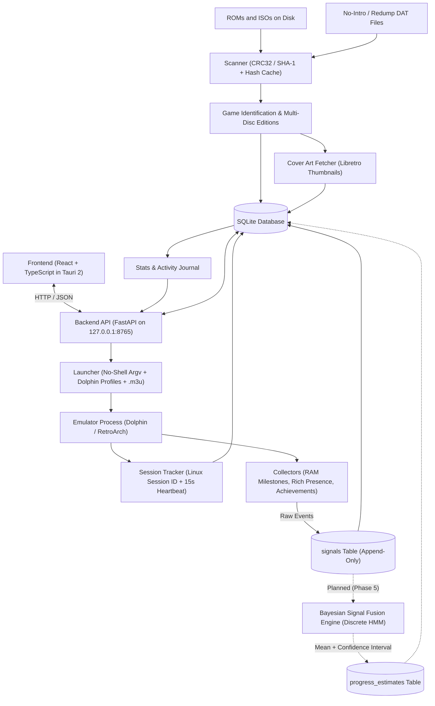
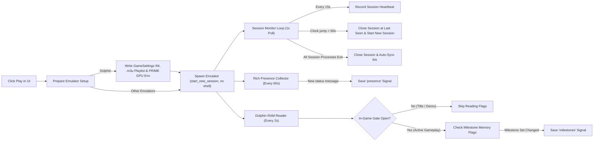
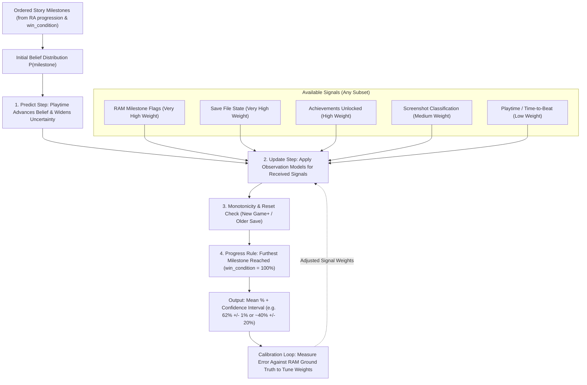

# Argos Launcher

**Argos Launcher** is a local, offline-first Linux desktop game library and emulator launcher with a probabilistic **game completion estimator** powered by multi-signal Bayesian fusion.

While launchers like Playnite, LaunchBox, and ES-DE organize and launch your library, Argos focuses on answering a harder question: **how far through a game are you (%), and how certain is that estimate?**

> **Local-only & legal notice:** Everything runs locally on your machine with no mandatory cloud services (RetroAchievements is optional). Argos **never** downloads or distributes ROMs, ISOs, or copyrighted game assets — it only indexes and launches files you already own.

---

## Table of Contents

- [How the Project Works (End-to-End Flow)](#how-the-project-works-end-to-end-flow)
- [Play Session & Real-Time Signal Collection](#play-session--real-time-signal-collection)
- [How Game Completion Prediction Works (Planned — Phase 5)](#how-game-completion-prediction-works-planned--phase-5)
- [Project Roadmap: Built vs. Planned](#project-roadmap-built-vs-planned)
- [What Has Been Built So Far](#what-has-been-built-so-far)
- [What Is Planned Next](#what-is-planned-next)
- [Tech Stack & Repository Structure](#tech-stack--repository-structure)
- [SQLite Data Model](#sqlite-data-model)
- [Getting Started](#getting-started)

---

## How the Project Works (End-to-End Flow)

Argos runs as a **Tauri 2** desktop app (or local web app) backed by a **Python / FastAPI** server and a local **SQLite** database. Every major piece of the app connects through a clean, layered pipeline:



### Step-by-step walkthrough

1. **Index your library (`scanner/`):** Argos scans your configured ROM/ISO folders, computes CRC32 and SHA-1 hashes (stripping 16-byte headers where required, such as NES), caches hashes by path/size/mtime so multi-GB ISOs are not re-hashed unnecessarily, and matches them against No-Intro and Redump DAT files. Multi-disc titles (`(Disc 1)`, `(Disc 2)`) are grouped into a single edition, and box art is downloaded once from Libretro Thumbnails and cached locally.
2. **Launch safely (`launcher/` + `emulators/`):** When you click **Play**, Argos spawns the emulator directly with an argument list (never through a shell, preventing command injection from filenames). For Dolphin, it can also apply per-game video/GPU/HD texture settings, controller presets, and auto-generated `.m3u` multi-disc playlists.
3. **Track sessions accurately (`sessions/`):** Each launch starts a new Linux process session (`start_new_session`). Argos monitors the entire session — even when wrapped by Flatpak or shell scripts — writing a heartbeat every 15 seconds and splitting sessions if the system suspends.
4. **Collect raw signals (`collectors/`):** During play (or on manual sync), pluggable `Collector` modules record immutable events into the `signals` table: RetroAchievements unlocks, Rich Presence status lines, and live RAM milestone flags.
5. **Estimate progress (Planned — Phase 5):** Because raw signals are always preserved in `signals`, the Bayesian fusion engine can combine whatever signals exist for a game into a completion percentage with an explicit uncertainty range — and reprocess the entire history whenever the model improves.

---

## Play Session & Real-Time Signal Collection

Here is what happens behind the scenes from the moment you click **Play** until you close the emulator:



- **Why the "In-Game Gate" matters:** Reading RAM on a title screen or attract-mode demo can produce false positives. Argos parses fixed-text lines from the game's RetroAchievements Rich Presence script to build an automatic gate that only allows RAM milestone reads during real gameplay.
- **Crash-safe sessions:** If the app crashes while an emulator is open, `close_orphans` closes any dangling session at its last 15-second heartbeat on the next startup so playtime is never inflated.

---

## How Game Completion Prediction Works (Planned — Phase 5)

Estimating **"how much of a game is completed"** is the core engineering and AI problem of Argos.

### Why it is harder than it looks

- A **ROM or ISO never stores progress** — it is static game data used only to identify the title. Real progress lives in **live RAM** and **save files**.
- **"Achievements earned ÷ total achievements" is not story progress.** A game like Resident Evil 2 has 173 RetroAchievements, of which only 58 are `progression` and 2 are `win_condition` — the rest are missable challenges, speedruns, or optional tasks.
- **No single signal exists for every game.** Some games have RAM maps and RetroAchievements; others only have playtime.

### Signal Hierarchy (Most Reliable to Least Reliable)

| Priority | Signal Source | Reliability | Role in Estimation | Status |
| :---: | :--- | :--- | :--- | :--- |
| 1 | **Live Emulator RAM Reading** | Very High | Reads exact story milestone flags in real time | Implemented (Dolphin / RA rules) |
| 2 | **Save File Parsing** | Very High | Reads persisted story state directly from saves | Planned (Phase 5) |
| 3 | **Achievements (RetroAchievements)** | High (Partial) | Proves the player reached *at least* a given milestone | Implemented (Sync + Auto-Milestones) |
| 4 | **Vision-Classified Screenshots** | Medium | Local vision model estimates current area/chapter | Planned (Phase 6) |
| 5 | **Playtime ÷ Typical Time to Beat** | Low | Gently nudges the estimate when stronger signals are missing | Planned (Phase 5) |

### The Fusion Engine: Exact Discrete Bayesian Filter (HMM)

Instead of outputting a single brittle guess, Argos models main-story progress as a **latent variable** over an ordered list of story milestones (automatically extracted from RetroAchievements `progression` and `win_condition` achievements). Because a game has dozens of ordered milestones rather than an infinite continuous space, an **exact discrete Hidden Markov Model (HMM)** in pure NumPy is both fast and exact (no particle filter approximation needed):



### Key design principles of the estimator

1. **Belief distribution, not a single number:** The filter maintains a probability over every milestone. When strong signals (RAM) arrive, the distribution collapses tightly (`62% ± 1%`). When only playtime is available, the interval stays honestly wide (`~40% ± 20%`).
2. **Furthest milestone, not raw count:** Reaching milestone 5 without triggering optional milestone 3 means you are closer to the ending than someone who stopped at milestone 3.
3. **Explicit `win_condition` = 100%:** Completing a `win_condition` achievement marks the playthrough as 100% finished even if optional or skipped milestones were never triggered.
4. **Monotonicity with resets:** Progress almost never moves backward; loading an old save or starting New Game+ is handled as a reset event rather than corrupting the belief.
5. **Calibration against ground truth:** Games with live RAM reading act as ground truth to measure the error of weaker signals (like playtime or vision) and calibrate their observation weights for games without RAM maps.
6. **Reprocessable raw history:** Because every raw event is stored permanently in `signals`, updating the math or weights allows recomputing `progress_estimates` across your entire play history.

---

## Project Roadmap: Built vs. Planned

Argos is built in strict sequential phases — each phase must work end-to-end before moving to the next:

```mermaid
flowchart LR
    P1["Phase 1: Scanner, Library & Launcher (Done)"] --> P2["Phase 2: Sessions & Playtime Stats (Done)"]
    P2 --> P3["Phase 3: RetroAchievements Sync (Done)"]
    P3 --> P4["Phase 4: Live RAM Milestones & Rich Presence (Done)"]
    P4 --> P5["Phase 5: Bayesian Signal Fusion & Calibration (Planned)"]
    P5 --> P6["Phase 6: Vision, Per-Game RAG & Recommendations (Future)"]

    style P1 fill:#1f5132,color:#ffffff,stroke:#2e7d32
    style P2 fill:#1f5132,color:#ffffff,stroke:#2e7d32
    style P3 fill:#1f5132,color:#ffffff,stroke:#2e7d32
    style P4 fill:#1f5132,color:#ffffff,stroke:#2e7d32
    style P5 fill:#7a4f01,color:#ffffff,stroke:#d97706
    style P6 fill:#374151,color:#ffffff,stroke:#6b7280
```



| Phase | Scope | Completion Criterion | Status |
| :---: | :--- | :--- | :---: |
| **1** | Scanner + Library + Launcher | Scans ROM folders, matches No-Intro/Redump DATs, displays library, launches emulators | Done |
| **2** | Sessions + Playtime Statistics | Tracks play sessions reliably and displays time by game, platform, and day | Done |
| **3** | First Progress Signal (RetroAchievements) | Syncs achievements per game with secure write-only credentials | Done |
| **4** | Real-Time RAM Reading & Auto-Milestones | Extracts story milestones from RA sets and reads live RAM flags during Dolphin sessions | Done |
| **5** | Signal Fusion + Calibration | Discrete Bayesian filter (HMM) producing `% ± confidence interval`, calibrated against RAM | **Planned** |
| **6** | Vision, Per-Game RAG & Recommendations | Local Ollama screenshot classifier, `sqlite-vec` embeddings, and recommendations | **Future** |

---

## What Has Been Built So Far

### Core Library, Scanning & Launching (Phase 1)
- **ROM/ISO Scanner (`backend/app/scanner/`):** Computes CRC32 and SHA-1 hashes with NES header stripping, caches hashes by file path/size/mtime, and matches against No-Intro and Redump DATs. Unmatched raw ROMs/ISOs and compressed disc images (`.chd`, `.rvz`) are listed as unidentified, while archive files (`.zip`, `.7z`, `.rar`) are skipped.
- **Multi-Disc Editions (`backend/app/editions.py`):** Automatically groups `(Disc 1)`, `(Disc 2)`, etc. into a single library entry and generates `.m3u` playlists with `Core.AutoDiscChange` for Dolphin.
- **Cover Art (`backend/app/covers.py`):** Fetches box art once from Libretro Thumbnails on GitHub and caches it locally in `covers/`.
- **Emulator Auto-Detection (`backend/app/emulators/detect.py`):** Automatically detects installed Dolphin (Flatpak or native) and RetroArch cores (matching platforms via `.info` database fields) without overriding user choices.
- **Safe Process Launcher (`backend/app/launcher/launch.py`):** Launches emulators via argument lists with `shell=False` and prevents duplicate launches of the same game or multi-disc edition.

### Sessions & Activity Tracking (Phase 2)
- **Session Tracker (`backend/app/sessions/tracker.py`):** Tracks entire Linux process sessions (`start_new_session`), writes 15-second heartbeats, splits sessions across system suspend gaps (> 60s), and closes orphaned sessions on startup.
- **Activity Journal & Stats (`backend/app/stats/play_time.py`, `Journal.tsx`, `Stats.tsx`):** Daily play journal grouping sessions per title (across multi-disc editions) alongside playtime charts by game, platform, and date.

### RetroAchievements & Live RAM Milestones (Phases 3 & 4)
- **Write-Only Credentials (`backend/app/api_ra.py`, `ra_store.py`):** Stores the RetroAchievements username and Web API key in the local SQLite database (`600` permissions), and writes the Dolphin login `ApiToken` directly to Dolphin's `RetroAchievements.ini`. Secrets are never returned by any route or exposed in error messages/URLs.
- **Auto-Linking & Sync (`ra_hash.py`, `ra_sync.py`):** Supports manual game ID/URL linking or automatic GameCube disc hashing (`rc_hash`), plus per-game and bulk achievement sync recorded as `achievements` signals.
- **Rich Presence Collector (`collectors/presence.py`, `rich_presence.py`):** Polls `API_GetUserSummary` every 60 seconds during active sessions and stores `presence` signals ("Where you left off").
- **Auto-Milestones & Live Dolphin RAM Reader (`milestones.py`, `ra_flags.py`, `ram_milestones.py`, `dolphin_memory.py`):** Extracts `progression` and `win_condition` achievements, groups multi-scenario games (e.g., Resident Evil 2's Leon A/B and Claire A/B via `[tag]` prefixes), derives an automatic "in-game" gate from the Rich Presence script, and polls Dolphin MEM1 every 2 seconds to record `milestones` signals.

### Desktop Shell, Dolphin Profiles & UI
- **Tauri 2 Desktop App (`frontend/src-tauri/`):** Opens the React UI and automatically starts/stops the local FastAPI backend on port `8765` (reusing an existing instance if already running).
- **Dolphin Profiles (`backend/app/emulators/dolphin.py`, `GameDolphin.tsx`):** Configures Vulkan/OpenGL backend, PRIME NVIDIA GPU offloading, internal resolution, anisotropy, VSync, validated HD texture pack installation (via `7z`), and Player 1 controller presets without opening Dolphin's GUI.
- **SDL3 Controller Auto-Detection:** Queries system SDL3 via `ctypes` (with `/proc/bus/input/devices` fallback) to detect connected gamepads and build Dolphin-compatible `SDL/<n>/<name>` device strings.
- **UI (Portuguese pt-BR):** Three main areas — **Acervo** (Library with spotlight, media views, grid/list, dark & light themes), **Atividade** (Journal, Achievements & Stats), and **Oficina** (Emulators, Controllers, Folders, Accounts).

---

## What Is Planned Next

### Phase 5 — Signal Fusion & Calibration (Next Major Milestone)
- **Progress Engine (`backend/app/progress/`):** Implement the pure-NumPy exact discrete Bayesian filter (HMM) consuming the `signals` table and writing calibrated mean + lower/upper bounds to `progress_estimates`.
- **Milestone Metadata & Ordering:** Persist achievement `kind` (`progression` vs. `win_condition`) and ordering so the estimator measures distance from the **furthest milestone** reached and locks completion at `100%` upon `win_condition`.
- **Multi-Scenario Aggregation:** Define how multi-route games (such as RE2's four scenarios) roll up into an overall game completion percentage.
- **Additional Signals:** Add save-file parsing and typical time-to-beat priors (manual entry or IGDB `game_time_to_beats`).
- **Calibration & Synthetic Tests:** Measure estimation error against live RAM ground truth and add automated pytest suites with synthetic signal streams.
- **Derived Insights:** Progress pace, abandoned-game detection, and estimated hours remaining.

### Phase 6 & Longer-Term Improvements
- **Local Vision Signal:** Classify gameplay screenshots with a local Ollama vision model as a medium-reliability progress signal.
- **Per-Game RAG & Recommendations:** Store local embeddings with `sqlite-vec` for per-game context and library recommendations.
- **Broader Emulator & Platform Support:** Add RetroArch UDP `READ_CORE_MEMORY` support, DuckStation / PCSX2 PINE memory sockets, and PC/Steam game tracking.
- **Packaged Installer:** Bundle the Python backend as a Tauri sidecar for standalone distribution.

---

## Tech Stack & Repository Structure

| Layer | Technology |
| :--- | :--- |
| Target OS | Linux |
| Desktop Shell & UI | Tauri 2 (Rust) + React 18 + TypeScript (Vite) |
| Backend | Python 3.12 + FastAPI (local process on `127.0.0.1:8765`) |
| Database | SQLite (`sqlite3`; `sqlite-vec` planned for Phase 6) |
| Signal Fusion (Phase 5) | Pure NumPy (custom exact discrete Bayesian filter) |
| Local AI Models (Phase 6) | Ollama (vision & LLM) |

```text
game-emulator/
├── backend/
│   ├── app/
│   │   ├── main.py                # FastAPI entrypoint, CORS, orphan session cleanup
│   │   ├── api.py                 # Core library, scan, launch, session & stats routes
│   │   ├── api_dolphin.py         # Dolphin video, texture pack & controller routes
│   │   ├── api_ra.py              # RetroAchievements credentials, linking & sync routes
│   │   ├── db/                    # SQLite schema & connection management
│   │   ├── scanner/               # DAT parser, CRC32/SHA-1 hasher, directory scanner
│   │   ├── emulators/             # Auto-detection, Dolphin INI/GPU/textures/MEM1 reader
│   │   ├── launcher/              # No-shell process launcher
│   │   ├── sessions/              # Linux session tracker & heartbeat loop
│   │   ├── collectors/            # Pluggable Collector interface (RA, Rich Presence, RAM)
│   │   ├── milestones.py          # Automatic milestone extraction from RA sets
│   │   ├── editions.py            # Multi-disc grouping & .m3u generation
│   │   ├── covers.py              # Libretro Thumbnails cover downloader & cache
│   │   └── stats/                 # Playtime & journal aggregations
│   └── tests/                     # Pytest suite (hashing, detection, Dolphin, RA, milestones)
└── frontend/
    ├── src/
    │   ├── pages/                 # Library, GamePage, Journal, Achievements, Stats, Emulators, Accounts, Settings
    │   └── ...                    # Shared components, API client, collection helpers
    └── src-tauri/                 # Tauri 2 Rust desktop shell
```

---

## SQLite Data Model

All state is stored locally in SQLite:

- `settings` — JSON key/value configuration (ROM folders, DAT folders, preferences).
- `games` — Identified and unidentified titles (`id`, unique key, title, platform, cover path).
- `files` — Individual ROM/ISO files linked to a game, storing `size`, `mtime_ns`, and cached `crc32`/`sha1` (with and without headers).
- `emulators` — Configured emulator executables and argument templates per platform.
- `sessions` — Play sessions (`started_at`, `ended_at`, `last_heartbeat`); duration is computed on query.
- `game_profiles` — Per-game emulator profile overrides (e.g., Dolphin video/GPU settings).
- `ra_games` & `ra_achievements` — RetroAchievements game links and synced achievement catalog/progress metadata.
- `milestones` & `milestone_groups` — Ordered story milestones per game/scenario with RAM flag addresses, values, and in-game gates.
- `signals` — Append-only raw event log (`game_id`, nullable `session_id`, `type`, JSON `payload`, `timestamp`) for achievements, rich presence, RAM milestones, and future signals.
- `progress_estimates` — Estimated completion records (`mean`, `lower`, `upper`, `timestamp`) populated by Phase 5 signal fusion.

---

## Getting Started

### Prerequisites

- **Linux**
- **Python 3.12+** and [`uv`](https://docs.astral.sh/uv/)
- **Node.js** and [`pnpm`](https://pnpm.io/)
- **Rust / Tauri 2 toolchain** *(optional — only needed to run or build the desktop shell)*

### Install Dependencies

```bash
cd backend && uv sync
cd ../frontend && pnpm install
```

### Run in Development

**Desktop app (Tauri — starts the backend automatically):**
```bash
cd frontend && pnpm tauri dev
```

**Web mode (two terminals):**
```bash
# Terminal 1 — Backend (http://127.0.0.1:8765)
cd backend && uv run uvicorn app.main:app --host 127.0.0.1 --port 8765

# Terminal 2 — Frontend (http://127.0.0.1:5173)
cd frontend && pnpm dev
```

### Run Checks & Tests

```bash
# Backend tests
cd backend && uv run pytest

# Frontend type-check & production build
cd frontend && pnpm build
```
